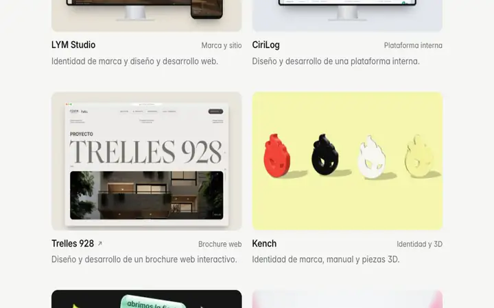
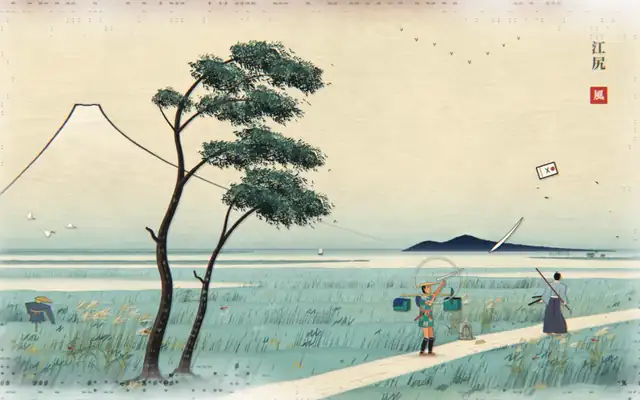
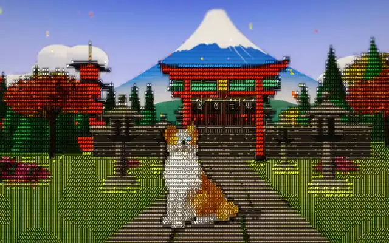
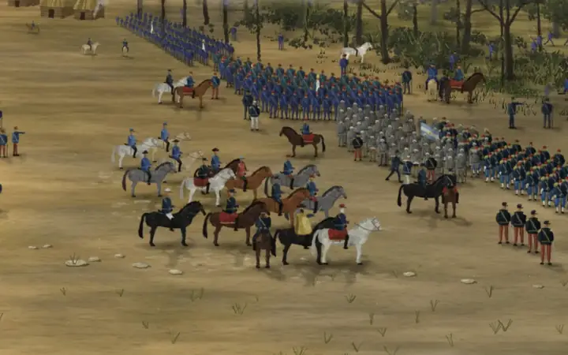
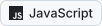
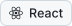
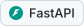

<table>
<tr><td>

<b>Hola, soy Tomás 👋</b> 
Diseñador en Buenos Aires. Diseño marcas, sitios y productos. Tomo proyectos freelance.

</td></tr>
<tr><td>

 

</td></tr>
<tr><td>

<b>diseño y motion</b> 
<picture><source media="(prefers-color-scheme: dark)" srcset="https://github.com/manuxxaitos/manuxxaitos/raw/main/assets/tools/figma-oscuro.svg"></picture>
<picture><source media="(prefers-color-scheme: dark)" srcset="https://github.com/manuxxaitos/manuxxaitos/raw/main/assets/tools/after-effects-oscuro.svg"></picture>
<picture><source media="(prefers-color-scheme: dark)" srcset="https://github.com/manuxxaitos/manuxxaitos/raw/main/assets/tools/premiere-oscuro.svg"></picture>

</td></tr>
<tr><td>

<b>web</b> 
<picture><source media="(prefers-color-scheme: dark)" srcset="https://github.com/manuxxaitos/manuxxaitos/raw/main/assets/tools/html-oscuro.svg"></picture>
<picture><source media="(prefers-color-scheme: dark)" srcset="https://github.com/manuxxaitos/manuxxaitos/raw/main/assets/tools/css-oscuro.svg"></picture>
<picture><source media="(prefers-color-scheme: dark)" srcset="https://github.com/manuxxaitos/manuxxaitos/raw/main/assets/tools/javascript-oscuro.svg"></picture>
<picture><source media="(prefers-color-scheme: dark)" srcset="https://github.com/manuxxaitos/manuxxaitos/raw/main/assets/tools/typescript-oscuro.svg"></picture>
<picture><source media="(prefers-color-scheme: dark)" srcset="https://github.com/manuxxaitos/manuxxaitos/raw/main/assets/tools/three-js-oscuro.svg"></picture>
<picture><source media="(prefers-color-scheme: dark)" srcset="https://github.com/manuxxaitos/manuxxaitos/raw/main/assets/tools/gsap-oscuro.svg"></picture>
<picture><source media="(prefers-color-scheme: dark)" srcset="https://github.com/manuxxaitos/manuxxaitos/raw/main/assets/tools/astro-oscuro.svg"></picture>
<picture><source media="(prefers-color-scheme: dark)" srcset="https://github.com/manuxxaitos/manuxxaitos/raw/main/assets/tools/react-oscuro.svg"></picture>
<picture><source media="(prefers-color-scheme: dark)" srcset="https://github.com/manuxxaitos/manuxxaitos/raw/main/assets/tools/fastapi-oscuro.svg"></picture>
<picture><source media="(prefers-color-scheme: dark)" srcset="https://github.com/manuxxaitos/manuxxaitos/raw/main/assets/tools/sqlite-oscuro.svg"></picture>

</td></tr>
<tr><td>

<b>ia y automatización</b> 
<picture><source media="(prefers-color-scheme: dark)" srcset="https://github.com/manuxxaitos/manuxxaitos/raw/main/assets/tools/claude-code-oscuro.svg"></picture>
<picture><source media="(prefers-color-scheme: dark)" srcset="https://github.com/manuxxaitos/manuxxaitos/raw/main/assets/tools/api-de-anthropic-oscuro.svg"></picture>
<picture><source media="(prefers-color-scheme: dark)" srcset="https://github.com/manuxxaitos/manuxxaitos/raw/main/assets/tools/codex-oscuro.svg"></picture>
<picture><source media="(prefers-color-scheme: dark)" srcset="https://github.com/manuxxaitos/manuxxaitos/raw/main/assets/tools/whisper-oscuro.svg"></picture>
<picture><source media="(prefers-color-scheme: dark)" srcset="https://github.com/manuxxaitos/manuxxaitos/raw/main/assets/tools/python-oscuro.svg"></picture>
<picture><source media="(prefers-color-scheme: dark)" srcset="https://github.com/manuxxaitos/manuxxaitos/raw/main/assets/tools/ffmpeg-oscuro.svg"></picture>
<picture><source media="(prefers-color-scheme: dark)" srcset="https://github.com/manuxxaitos/manuxxaitos/raw/main/assets/tools/opencv-oscuro.svg"></picture>
<picture><source media="(prefers-color-scheme: dark)" srcset="https://github.com/manuxxaitos/manuxxaitos/raw/main/assets/tools/playwright-oscuro.svg"></picture>

</td></tr>
</table>

Todo lo de arriba se mueve: entrá a <a href="https://tomascardozo.com">tomascardozo.com</a>. El código del portfolio está en <a href="https://github.com/manuxxaitos/portfolio-2026">portfolio-2026</a>.
